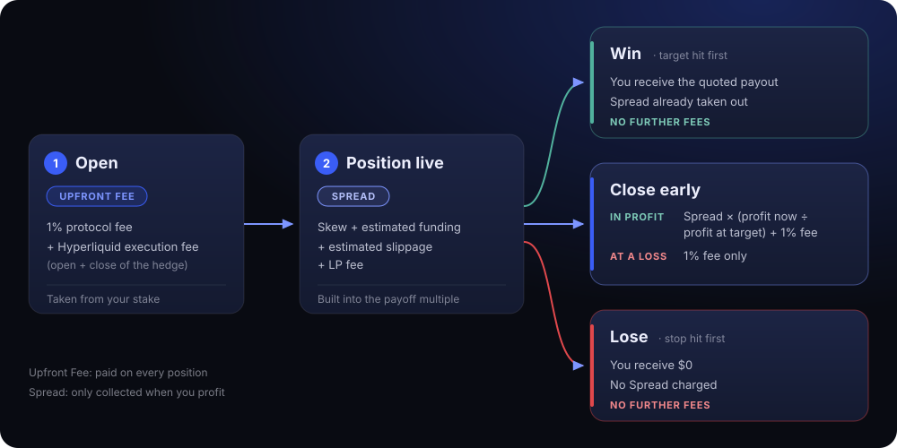

# Fees

Boundaries have three types of fees: the **Upfront Fee**, the **Spread** and the **Early Close** fee.

| Category | When | What it includes |
| --- | --- | --- |
| **Upfront Fee** | Taken from your USDC stake at open | Protocol fee + Hyperliquid execution fee for opening and closing the hedge |
| **Spread** | Built into the payoff multiple shown in your quote | Skew + estimated funding + LP fee + estimated slippage for opening and closing the hedge |
| **Early Close** | Taken when you close early | Your share of the Spread so far (only if in profit) + early-close fee |

Rates can change over time. Changes only apply to new positions. Open positions keep the rates they were opened with.

## Upfront Fee

The Upfront Fee is taken from your stake when you open a position. It includes:

* **Protocol fee:** 1% of your stake.
* **Hyperliquid execution fee:** 4.5 bp of the hedge size, charged twice (once to open the hedge, once to close it).

Your payout is calculated on the remaining stake.

## Spread

The Spread is included in the payoff multiple of your quote. It includes:

* **Skew:** an extra charge if your position adds to the book's imbalance, or a discount if it reduces it.
* **Estimated funding:** the expected funding cost of the hedge.
* **LP fee:** the liquidity pool's fee.
* **Estimated slippage:** for opening and closing the hedge. Larger hedges have more slippage.

The Spread is only collected if you win. If you lose, no Spread is charged.

## Early Close

The Early Close fee depends on whether your position is in profit:

| Your position | Early Close fee |
| --- | --- |
| In profit | Spread × (your profit now ÷ your profit at target) + early-close fee |
| At a loss or break-even | Early-close fee only |

For example, if your profit is halfway to your profit at target, you pay half the Spread. The early-close fee is 1%.

Current Value in the app is the amount you receive if you close now, after the Early Close fee.

## Example

$20 on BTC Up, stop 5% below, target 5% above (2× fair payout). Uses BTC's current rates: 4.5 bp Hyperliquid fee, 10.5% yearly funding, 1.6% daily volatility, 3.5% LP fee, no skew.

| Step | Amount |
| --- | --- |
| Stake | $20.00 |
| Upfront Fee ($0.20 protocol + $0.35 Hyperliquid execution) | −$0.55 |
| Fair payout at 2× (on the $19.45 left) | $38.90 |
| Spread at target (LP fee, funding, slippage) | −$3.71 |
| **You receive if BTC hits the target (5% above) before the stop** | **$35.19** |

Early close on the same position:

| Price | Value | Spread share | You receive (after 1% early-close fee) |
| --- | --- | --- | --- |
| Unchanged since open | $19.45 | $0 | $19.26 |
| Halfway to target | $29.17 | $1.75 | $27.16 |
| Halfway to stop | $9.72 | $0 | $9.63 |
| Stop hit first | $0 | $0 | $0 |
